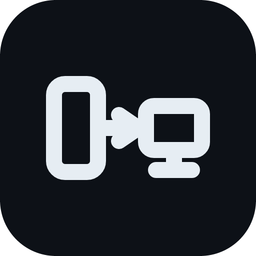

<p align="center">
  
  <br>
  <h1>ScrcpyGUI v4</h1>
  <strong>A native, high-performance Android control experience.</strong>
</p>

---

ScrcpyGUI v4 is a desktop GUI for [scrcpy](https://github.com/Genymobile/scrcpy).
The GUI is built entirely in Rust with [Rune](https://github.com/anomalyco/rune),
a native GPU-rendered UI framework; the scrcpy/adb logic is also Rust. There is
no webview, no Node.js build step and no mocked backend.

## Features

- Native GPU UI with the official Rune/OpenCode theme, light/dark/system appearance,
  a device-first flat shell, fixed action bar and settings drawer
- USB and wireless device discovery, Android 11+ pairing, Wi-Fi reconnect
- Screen mirroring, camera (webcam) and virtual-display desktop sessions
- Bitrate / FPS / resolution / codec / renderer / hardware-decoding controls
- HID keyboard and mouse, pure-HID mode, screen-off and keep-awake
- Recording, floating window position memory, borderless-window drag on Windows
- APK install and file push via native file picker
- Automatic scrcpy download with `SHA256SUMS.txt` verification and update check
- System console with adb command entry
- OS shortcuts: `Ctrl+Alt+Shift+C` recenter, `Ctrl+Alt+Shift+W` drag (Windows)

## Getting started

Read [GUIDE.md](GUIDE.md) for device setup (USB debugging, wireless pairing).

### Development

Requires Rust 1.99.1 (pinned in `rust-toolchain.toml`), Python 3.11+ (standard
library only) and the platform UI libraries (X11/Wayland/ALSA on Linux,
Visual Studio C++ build tools on Windows).

```bash
python scripts/check.py                      # full gate: fmt, clippy, tests, visual
python scripts/check.py --fast               # Rust + consistency checks only
cargo run -p scrcpy-gui                      # launch the native app
cargo build --release -p scrcpy-gui          # release binary
cargo run -q -p scrcpy-gui -- --snap out.png --tree tree.json   # headless UI check
```

`scripts/check.py` is the single gate definition used by both developers and
CI. See [CONTRIBUTING.md](CONTRIBUTING.md) for the full workflow: visual
baselines, i18n catalogs, Rune upgrades, version bumps and releases.

Rune is pre-release: the workspace root pins a specific `dev` revision and its
required `[patch.crates-io]` forks. Keep all eleven pins in sync when upgrading
Rune (`scripts/check.py` enforces it).

Architecture details and known gaps are documented in [AGENTS.md](AGENTS.md).
